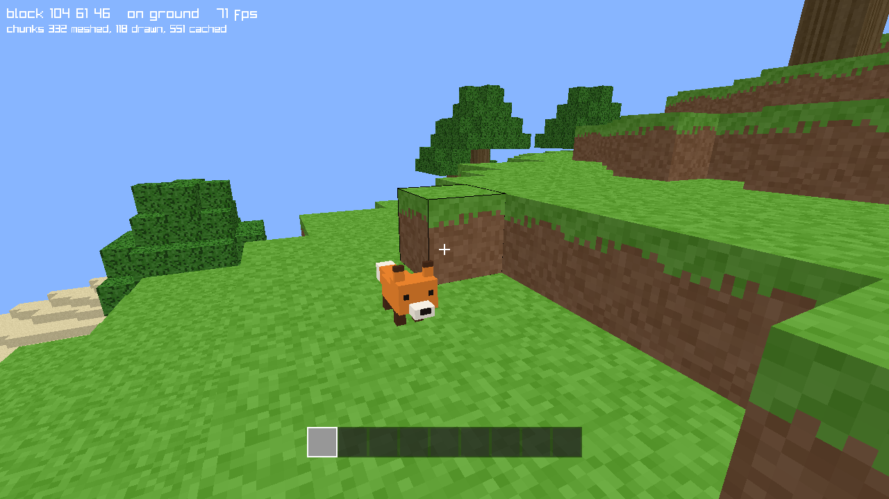

# lean-mc

A small Minecraft-style voxel game written in [Lean 4](https://lean-lang.org),
with its game logic proved correct.


Walk around generated terrain, dig blocks into your hotbar, place them again,
fly, and save and load. Foxes live in the world: about one column of chunks in
32 starts with one, and they wander about, hopping up where they have to. The
rules of the game are pure Lean functions with theorems about them; drawing and
input go through a thin C shim over [raylib](https://www.raylib.com).



## Running

macOS only for now. You need [elan](https://github.com/leanprover/elan) and the
Xcode command line tools.

```sh
lake build        # the first build downloads and builds raylib 5.5 into vendor/
lake exe leanmc
```

Options: `--seed N` picks the world, `--at X Y Z` picks where you start,
`--flat` gives a flat test world with no foxes, and `--load FILE` starts from a
saved game. Saved games in an older format are not loaded.

## Controls

| Input | Action |
| --- | --- |
| Click | Capture the mouse (`Esc` releases it) |
| Mouse | Look |
| `W` `A` `S` `D` | Move |
| `Space` | Jump, or rise while flying |
| `Shift` | Descend while flying |
| `Ctrl` | Sprint |
| `F` | Toggle flying |
| Left click | Dig |
| Right click | Place |
| `1`–`9` | Choose a hotbar slot |
| `F5` / `F9` | Save to / load from `lean-mc.save` |

## What is proved

The game is split into three parts:

- `LeanMc/Core` is the game itself: world storage, terrain, meshing, physics,
  the player and the foxes, loading, targeting, inventory, pacing, render
  planning and saving.
- `LeanMc/Proofs` has the theorems about the core.
- `LeanMc/Shell` and `ffi/shim.c` are the unverified shell: the frame loop, and
  the window, GPU objects and raw input.

The shell holds the game and the render planner as one value, a `Client`, which
it cannot build or take apart. It can only take the steps the core defines and
send the commands each step hands it.

Some of the headline results, for any seed and any sequence of inputs:

- **The game never goes wrong.** Neither the player nor any fox is ever inside
  a solid block, the bedrock floor is never broken, and none of them ever falls
  through it. The physics is proved once, for a body of any shape.
- **Loading belongs to the game, not the renderer.** The chunks near the player
  are loaded, and which those are is a function of the game state. A fox in an
  unloaded chunk does not move, and no edit can reach it. Every loaded column
  of chunks has had its foxes made, and a column's foxes are made once. The
  renderer draws the region the game says is loaded.
- **Foxes are part of the terrain.** Which columns have one is a function of
  the seed, so the world has the same foxes whatever order it is explored in.
  A world built by hand has the creatures it is given, and none otherwise.
- **Randomness is a value.** A fox's wandering is random, but the random number
  generator is part of the game state, so a tick is still a function of the
  state and the input. The generator is opaque to the proofs: no theorem
  depends on which numbers it gives.
- **What is drawn is what is there.** A face is in a chunk's mesh exactly when
  its block is visible and the block beside it is not opaque, and no face is
  emitted twice.
- **The picture follows the game.** After any run of the steps the shell can
  take, every meshed chunk's slot holds exactly the mesh of that chunk in the
  world as it now is, and no command sent misuses the shim. This is proved
  against a model of the shim, which the tests compare with the real one.
- **Blocks are conserved.** Digging and placing never duplicate a block or make
  one vanish, and a tick changes at most one block.
- **Presses are not lost or repeated**, however frames and ticks line up.
- **Save and load is the identity**, for the foxes, the populated columns and
  the random number generator as much as for the player and the blocks.

`LeanMc/Proofs/Audit.lean` checks that these rest only on Lean's three standard
axioms, so there is no `sorry` and no `native_decide`. Building the project is
the check.

## Tests

```sh
lake test                           # executable checks on the compiled core
cd proptest && lake exe cache get   # once; the property tests need Mathlib
lake test                           # property tests, using basalt
lake exe native                     # the real shim against its model (opens a window)
```

`lake exe native` also draws single block faces and reads pixels back. These
few checks are the only tests of what the shim puts on the screen.
