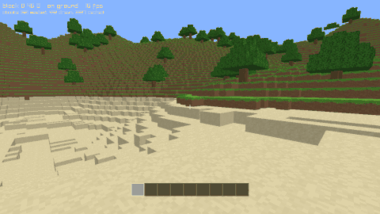

# lean-mc

A small Minecraft-style voxel game written in [Lean 4](https://lean-lang.org),
with its game logic proved correct.



Walk around generated terrain, dig blocks into your hotbar, place them again,
fly, and save and load. The rules of the game are pure Lean functions with
theorems about them; drawing and input go through a thin C shim over
[raylib](https://www.raylib.com).

## Running

macOS only for now. You need [elan](https://github.com/leanprover/elan) and the
Xcode command line tools.

```sh
lake build        # the first build downloads and builds raylib 5.5 into vendor/
lake exe leanmc
```

Options: `--seed N` picks the world, `--at X Y Z` picks where you start,
`--flat` gives a flat test world, and `--load FILE` starts from a saved game.

## Controls

| Input | Action |
| --- | --- |
| Click | Capture the mouse (`Esc` releases it) |
| Mouse | Look |
| `W` `A` `S` `D` | Move |
| `Space` | Jump, or rise while flying |
| `Shift` | Descend while flying |
| `Ctrl` | Sprint |
| `F` | Toggle flying |
| Left click | Dig |
| Right click | Place |
| `1`–`9` | Choose a hotbar slot |
| `F5` / `F9` | Save to / load from `lean-mc.save` |

## What is proved

The game is split into three parts:

- `LeanMc/Core` is the game itself: world storage, terrain, meshing, physics,
  targeting, inventory, pacing, render planning and saving.
- `LeanMc/Proofs` has the theorems about the core.
- `LeanMc/Shell` and `ffi/shim.c` are the unverified shell: the frame loop, and
  the window, GPU objects and raw input.

Some of the headline results, for any seed and any sequence of inputs:

- **The game never goes wrong.** The player is never inside a solid block, the
  bedrock floor is never broken, and the player never falls through it.
- **What is drawn is what is there.** A face is in a chunk's mesh exactly when
  its block is visible and the block beside it is not opaque, and no face is
  emitted twice.
- **Blocks are conserved.** Digging and placing never duplicate a block or make
  one vanish, and a tick changes at most one block.
- **Presses are not lost or repeated**, however frames and ticks line up.
- **Save and load is the identity.**

`LeanMc/Proofs/Audit.lean` checks that these rest only on Lean's three standard
axioms, so there is no `sorry` and no `native_decide`. Building the project is
the check.

## Tests

```sh
lake test                           # executable checks on the compiled core
cd proptest && lake exe cache get   # once; the property tests need Mathlib
lake test                           # property tests, using basalt
lake exe native                     # the real shim against its model (opens a window)
```
